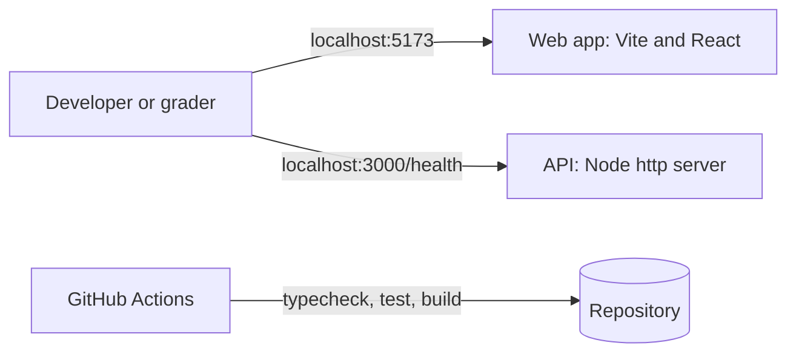
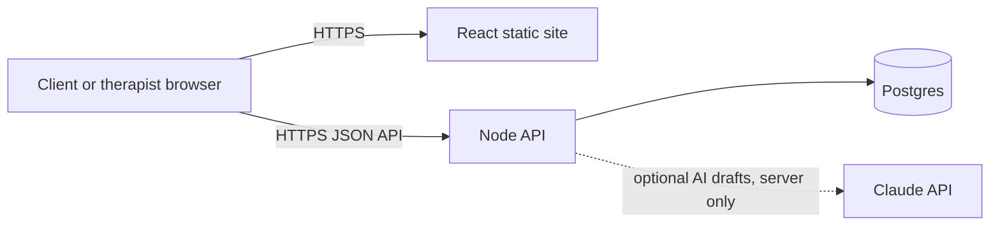

# Technical design

Updated November 4, 2026 for the Milestone 1 frontend. What runs today is small, so this document separates **what exists** from **what is planned**. Planned backend parts remain proposals awaiting team and partner agreement.

## Context

Between Sessions helps therapy clients reflect between appointments. See [requirements](requirements.md). The running web/API demo uses fictional data and has no login or database. The client summary screen can optionally invoke the local DeepSeek demo endpoint. A separate manually invoked local command checks DeepSeek connectivity with a fixed test message. Nothing is deployed.

*The web app calls `/api/health`, proxied by Vite to the local Node API. Business screens use explicitly labeled fictional fixtures. GitHub Actions checks the repository.*

## Components that exist

| Component | Location | What it does |
| --- | --- | --- |
| Web app | `apps/web` | React 19/TypeScript/Vite, hash-based client and therapist navigation, SOS placeholder, real API health, in-memory simulated draft states. No authenticated routes or business API calls. |
| API | `apps/api` | TypeScript on `node:http`. `src/server.ts` builds the server and `src/index.ts` starts it. No web framework has been chosen. |
| Contracts | `packages/contracts` | Zod schemas and inferred types for the DTOs and request bodies in the [API contract draft](project/api-contract-draft.md), with tests. No app imports it yet; the size limits in `src/common.ts` are proposals. |
| Database folder | `db` | README and empty `migrations/` and `seeds/` folders. No schema or database connection. |
| CI | `.github/workflows/ci.yml` | Runs `npm ci`, typecheck, tests, and build on every pull request and on pushes to `main`. |

Empty `.gitkeep` folders such as `apps/api/src/auth` mark intended locations. For local fictional prototyping, `apps/api/src/llm/deepseek.ts` and `scripts/check-deepseek.ts` provide a manually invoked DeepSeek connection check. It loads the Git-ignored root `.env.local`, reads `DEEPSEEK_API_KEY` and `DEEPSEEK_MODEL`, and sends a fixed test message over HTTPS. Tests mock the provider. The default HTTP server exposes `/health`. Opt-in local demo routing is described below. `.env.example` retains historical database and Anthropic placeholders.

## Interfaces and contracts

Frontend fixtures are typed in `apps/web/src/fixtures.ts` against the API draft. Therapist fixture objects include only allowlisted sent-letter fields, never private drafts. The demo role selector is not an authorization control. Business operations remain unavailable on the actual API. No provider SDK or keys are included in the browser.

Frontend visual authority is Figma Frontend v0.1: client warm-white/purple and therapist cool-white/blue-purple palettes in `styles.css`, with locally bundled Inter. Earlier repository palette suggestions do not override this user-selected source. Responsive layouts retain the 240px therapist sidebar on desktop and wrap navigation on mobile.

The one implemented interface:

| Request | Response |
| --- | --- |
| `GET /health` | `200`, `Content-Type: application/json`, body `{"status":"ok"}` |
| Any other path | `404` with an empty body |

Proposed workflow endpoints are in the [API contract draft](project/api-contract-draft.md) and are not implemented.

Local AI development now includes `generateSummary` in `apps/api/src/llm/summary.ts` and shared Zod schemas in `packages/contracts/src/ai-summary.ts`. The module uses DeepSeek JSON mode with fixed source-constrained instructions, a 30-second request timeout and output/source validation. Its caller supplies selected sources and a verified version. It returns an editable suggestion without persistence. The `ai:summary` command exercises it using fixed fictional inputs and prints their result. Automated tests mock the provider. The HTTP server invokes it through opt-in `POST /demo/ai-summary`, enabled by `AI_SUMMARY_DEMO=true` in development and bound to loopback. Development startup reads root `.env.local`. The route accepts explicit fictional answers and a caller-supplied version, bounds JSON request size and returns safe JSON errors with request IDs. Production disables this demo. The authenticated activity route and storage/version checks remain pending. The web summary screen now explicitly selects and previews reflection answers, requests a suggestion and offers adoption or discard. Editing the letter or leaving the summary screen aborts the browser request and clears stale suggestions. A client-issued source revision correlates requests and responses. Structural checks cannot establish source faithfulness.

The client summary now covers an explicitly selected treatment interval between two therapy-session dates. `WeeklySummary` includes all current tasks by default, their saved completion states, nested reflection answers and a separate personal-message field. The user confirms task membership because the demo has no authoritative task/session association. `generateWeeklySummary` preserves exact task records, validates interval narrative sources and returns both narrative and task progress. The letter includes every selected task's recorded status. Existing reflection-only callers continue to work.

## Data model

No data model exists at this commit. The proposed entities, such as User, TherapistClientLink, Appointment, Activity, PrivateReflectionResponse, PrivateSummaryDraft, and SentLetter, and who may see each, are in the [visibility matrix](project/mvp-scope-and-architecture.md#proposed-data-visibility-and-entity-ownership). The core rule proposed there: private drafts are never visible to therapists, and a sent letter is a fixed copy of what the client approved.

## Planned architecture

*Planned, not built: one React app and one Node API backed by Postgres. Only the API calls the LLM, and that call is optional.*

Selected in [tech stack research](research/baa-tech-stack.md) on October 25 and not yet implemented: Render for hosting, Render Postgres, Better Auth inside the API, and the Claude API. The team also chose to avoid AWS for now and to use TypeScript throughout. The proposed shape is one shared repository, one modular backend, and one responsive frontend with separate client and therapist routes. Native mobile and Apple Watch stay future directions to discuss. Module layout and ownership are proposed in [MVP scope](project/mvp-scope-and-architecture.md#architecture-target) and [team roles](project/team-roles-and-development-order.md).

## Deployment

**Current state:** nothing is deployed.

**Production target (proposed):** the walking skeleton will run on [Render](https://render.com) by fall week 10 (about December 6, 2026) as a Render static site serving `apps/web` and a Render web service running `apps/api`, with `GET /health` as the deployment check and the web app showing the API's status as the end-to-end slice. It will use fictional data only, so it does not need a HIPAA-enabled workspace or a BAA; those are required before any real patient data. The account owner is proposed to be Stanley Eng, to be confirmed by the team. **Justin Jacques, the project partner, has not yet agreed to this target.** The team (Zhicheng Huang, Jack Almutairi, Stanley Eng) owns getting that agreement, by November 5, 2026; the entry is in [the risk register](risks.md#external-prerequisites). This target also needs reconciling with the October 22 meeting's native App Store direction (Q-1 in [requirements](requirements.md#open-questions)).

Where changes will be exercised before users and how they will be undone are in [the risk register](risks.md#staging-and-rollback-plan).

## Decisions deferred on purpose

- **API web framework:** Hono, proposed on November 4, 2026 by Backend B. Not yet agreed by Backend A or Huang.
- **Database tooling, migrations and test database:** Backend A to choose. Backend B suggests Prisma, with `prisma dev` locally and a Postgres service in CI. Backend B's table needs are in the [workflow schema proposal](project/workflow-schema-proposal.md); see the [decision log](project/decisions-and-open-questions.md#decision-log-awaiting-agreement).
- **Shared contracts package:** `packages/contracts` exists as the proposed single source of request/response shapes. The API and web app adopt it only after the team agrees.
- **Native mobile:** responsive web first is recommended, pending Q-1.
- **Sending-window policy:** proposed as configurable until Q-3 is settled, so no timing rule is coded yet.

## Open technical questions

1. Can the skeleton stay on a low-cost Render plan until the pilot, and what will the HIPAA-enabled plan cost at pilot scale?
2. Which email provider, if any, sends login emails, and does it offer a BAA?
3. Does Render's rollback cover database migrations, or do migrations need their own down path?
4. Which frontend test tool should replace the `renderToString` smoke test once screens have behavior?
