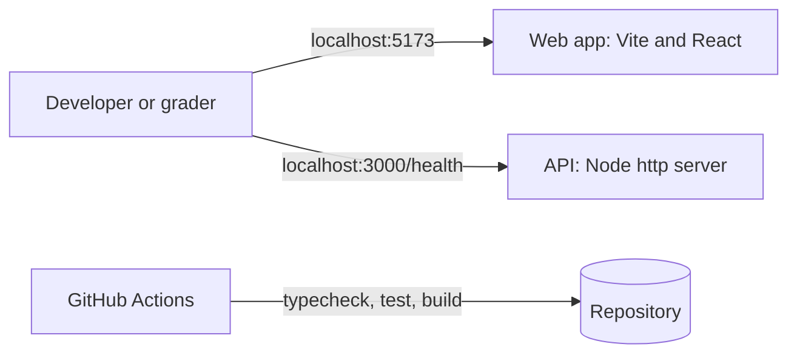
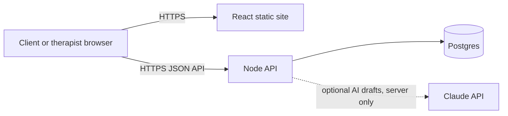

# Technical design

The system at November 1, 2026. What runs today is small, so this document separates **what exists** from **what is planned**. Planned parts are proposals awaiting team and partner agreement.

## Context

Between Sessions helps therapy clients reflect between appointments. See [requirements](requirements.md). Today there is no user data, login, database, or AI call in the running code, and nothing is deployed.

*The web app and API run separately on a developer's machine and do not call each other yet. GitHub Actions checks the repository.*

## Components that exist

| Component | Location | What it does |
| --- | --- | --- |
| Web app | `apps/web` | React 19 and TypeScript on Vite. `App.tsx` renders one heading. |
| API | `apps/api` | TypeScript on `node:http`. `src/server.ts` builds the server and `src/index.ts` starts it. No web framework has been chosen. |
| Database folder | `db` | README and empty `migrations/` and `seeds/` folders. No schema or database connection. |
| CI | `.github/workflows/ci.yml` | Runs `npm ci`, typecheck, tests, and build on every pull request and on pushes to `main`. |

Empty `.gitkeep` folders such as `apps/api/src/auth` and `apps/api/src/llm` mark intended locations and contain no code. `.env.example` lists `DATABASE_URL` and `ANTHROPIC_API_KEY`, but no code reads them; only `PORT` is used, and the API reads it from the process environment, not from `.env`.

## Interfaces and contracts

The one implemented interface:

| Request | Response |
| --- | --- |
| `GET /health` | `200`, `Content-Type: application/json`, body `{"status":"ok"}` |
| Any other path | `404` with an empty body |

Proposed workflow endpoints are in the [API contract draft](project/api-contract-draft.md) and are not implemented.

## Data model

No data model exists at this commit. The proposed entities, such as User, TherapistClientLink, Appointment, Activity, PrivateReflectionResponse, PrivateSummaryDraft, and SentLetter, and who may see each, are in the [visibility matrix](project/mvp-scope-and-architecture.md#proposed-data-visibility-and-entity-ownership). The core rule proposed there: private drafts are never visible to therapists, and a sent letter is a fixed copy of what the client approved.

## Planned architecture

*Planned, not built: one React app and one Node API backed by Postgres. Only the API calls the LLM, and that call is optional.*

Selected in [tech stack research](research/baa-tech-stack.md) on October 25 and not yet implemented: Render for hosting, Render Postgres, Better Auth inside the API, and the Claude API. The team also chose to avoid AWS for now and to use TypeScript throughout. Module layout and ownership are proposed in [MVP scope](project/mvp-scope-and-architecture.md#architecture-target) and [team roles](project/team-roles-and-development-order.md).

## Deployment

**Current state:** nothing is deployed.

**Production target (proposed):** the walking skeleton will run on [Render](https://render.com) by fall week 10 (about December 6, 2026) as a Render static site serving `apps/web` and a Render web service running `apps/api`, with `GET /health` as the deployment check and the web app showing the API's status as the end-to-end slice. It will use fictional data only, so it does not need a HIPAA-enabled workspace or a BAA; those are required before any real patient data. The account owner is proposed to be Stanley Eng, to be confirmed by the team. **Justin Jacques, the project partner, has not yet agreed to this target.** The team (Zhicheng Huang, Jack Almutairi, Stanley Eng) owns getting that agreement, by November 5, 2026; the entry is in [the risk register](risks.md#external-prerequisites). This target also needs reconciling with the October 22 meeting's native App Store direction (Q-1 in [requirements](requirements.md#open-questions)).

Where changes will be exercised before users and how they will be undone are in [the risk register](risks.md#staging-and-rollback-plan).

## Decisions deferred on purpose

- **API web framework:** the placeholder server is enough until real routes exist.
- **Migration tool:** no schema exists yet.
- **Shared contracts package:** added only when both apps consume it.
- **Native mobile:** responsive web first is recommended, pending Q-1.
- **Sending-window policy:** proposed as configurable until Q-3 is settled, so no timing rule is coded yet.

## Open technical questions

1. Can the skeleton stay on a low-cost Render plan until the pilot, and what will the HIPAA-enabled plan cost at pilot scale?
2. Which email provider, if any, sends login emails, and does it offer a BAA?
3. Does Render's rollback cover database migrations, or do migrations need their own down path?
4. Which frontend test tool should replace the `renderToString` smoke test once screens have behavior?
